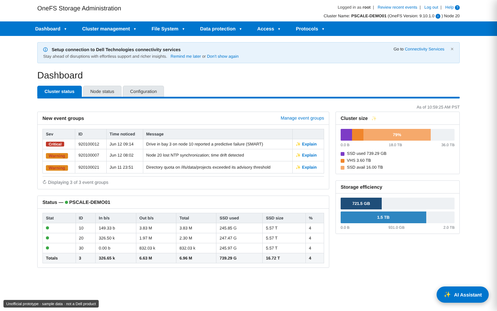
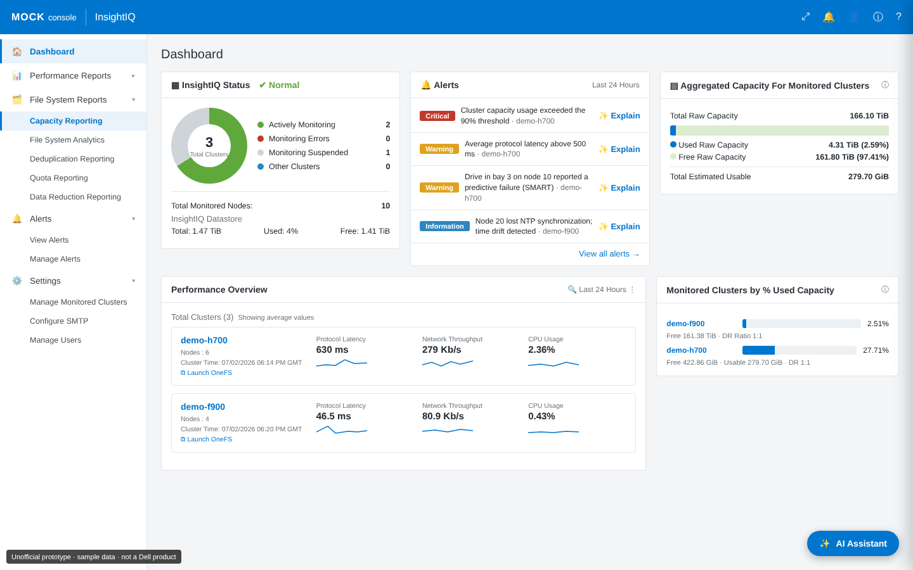

# OneFS Admin Assistant

A fully local, documentation-grounded AI assistant embedded in two storage admin consoles: a **OneFS WebUI** mock and an **InsightIQ** mock. An admin asks a question in plain English and gets an answer drawn only from the vendor's public documentation, with citations and copyable `isi` CLI commands. Nothing leaves the machine.

> **Personal prototype. Not affiliated with, endorsed by, or a product of Dell Technologies.** The consoles are hand-built mocks with fictional sample data. The knowledge base is built from publicly downloadable product manuals, which are fetched by script and not redistributed here. PowerScale, OneFS and InsightIQ are trademarks of their owner.



---

## The product idea

Storage admins work inside a management console, but answers live in a dozen PDF manuals. Each "how do I…?" means leaving the console, searching a 600-page guide and mapping the answer back to the GUI. The assistant puts the answer where the question happens:

- **Grounded, not generative.** Answers come only from the manuals. If retrieval finds nothing relevant, it says it doesn't have enough information instead of guessing, and hides citations.
- **Two assistants, one engine.** The same backend serves both consoles.
- **Scope wall.** The WebUI assistant retrieves from OneFS docs only. The InsightIQ assistant retrieves from OneFS + InsightIQ docs, so it can answer performance questions *and* explain alerts from the event reference.
- **Performance redirect.** Ask the WebUI a performance question and it doesn't bluff: it shows a card pointing you to InsightIQ, where that data lives.
- **Actionable answers.** "Explain this event/alert" buttons, ✨ inline field helpers, click-to-navigate links, and fenced `isi …` commands you can copy.
- **Local by design.** For air-gapped and security-sensitive sites, the model, embeddings and vector store all run on the box.



## Architecture

```
Browser ──http──> Flask (web/server_local.py, :8501)
                     │  serves web/index.html (OneFS WebUI mock) and web/insightiq.html
                     │  POST /api/chat {question, context, product} → SSE stream
                     ▼
             embed query (nomic-embed-text)
                     ▼
             ChromaDB (cosine, collection "onefs_docs", product-tagged)
                     │   product=onefs     → OneFS docs only
                     │   product=insightiq → OneFS + InsightIQ docs
                     ▼
             LLM (qwen2.5:3b-instruct) → grounded answer + citations → browser
```

Request-flow diagrams: [OneFS WebUI](diagrams/onefs-webui-assistant-flow.svg) · [InsightIQ](diagrams/insightiq-assistant-flow.svg) · [plain-English version](diagrams/how-it-works.svg)

**Two interchangeable engines, same prompt, same answers:**

| Engine | When | Notes |
|---|---|---|
| In-process llama-cpp (default) | CPU-only machines | The model runs inside the Python process: one process, no model server |
| Ollama (`USE_OLLAMA=1`) | NVIDIA GPU present | ~13 s answers vs minutes on CPU; falls back to in-process if Ollama is down or lacks the model |

## Stack

| Layer | Choice |
|---|---|
| Chat model | `qwen2.5:3b-instruct` (reliably emits fenced CLI commands) |
| Embeddings | `nomic-embed-text` |
| LLM runtime | llama-cpp-python 0.2.90 (CPU, AVX2) or Ollama (GPU) |
| Vector store | ChromaDB 0.6, cosine, product-tagged |
| Backend | Flask 3.1, SSE streaming |
| Ingest | LlamaIndex 0.12 + pypdf (build time only) |
| Frontend | single-file HTML/CSS/JS per console |

## Run it

1. Install Python 3.11, and optionally [Ollama](https://ollama.com/download) for the GPU path.
2. `powershell -ExecutionPolicy Bypass -File download_docs.ps1` downloads the public OneFS manuals into `docs/`.
3. `SETUP.bat` creates the venv, installs packages, pulls the models and builds the vector DB.
4. Optional InsightIQ knowledge: put the InsightIQ admin guide (and any node-performance reports exported from your own InsightIQ) in `docs/insightiq/`, then run `python ingest_insightiq.py` and `python tag_products.py`.
5. `START.bat` (CPU) or `START-DEMO-GPU.bat` (GPU), then open http://localhost:8501.

```powershell
curl http://localhost:8501/api/health      # {"ok":true,"engine":"llamacpp"|"ollama"}
```

Model weights, the vector DB and the manuals are gitignored.

## Tuning

CPU inference is dominated by prompt prefill (~40 tok/s), so context size is the main latency lever.

| Setting | CPU default | GPU default | Meaning |
|---|---|---|---|
| `TOP_K` / `TOP_K_GPU` | 5 | 8 | passages retrieved |
| `PROMPT_CHARS` / `PROMPT_CHARS_GPU` | 1300 | 1800 | per-passage character cap |
| `N_THREADS` | cores − 2 | — | leaves headroom for the host's real workload |
| `MAX_TOKENS` | 500 | 500 | answer length cap |

## What I learned building it

- **Smaller and resident beats bigger and partial.** On a 6 GB GPU, `llama3.1:8b` (26/33 layers fit) took ~47 s; `qwen2.5:3b` fully in VRAM took ~13 s.
- **Model choice decides whether you get a CLI command at all.** `llama3.2:3b` never emitted the `isi` command at any context size; `qwen2.5:3b` did, but only with full excerpts (`TOP_K=8`, `PROMPT_CHARS=1800`). Truncated passages clip commands off the end.
- **There is no fast CPU path.** llama-cpp and Ollama-on-CPU both prefill at ~40 tok/s, so the GPU is the only real speed-up.
- **Pin llama-cpp-python 0.2.90.** Newer wheels are AVX-512 builds and crash (`0xc000001d`) on 12th/13th-gen consumer Intel CPUs.
- **Force Ollama's `cuda_v12` runner on Ampere** (`OLLAMA_LLM_LIBRARY=cuda_v12`); the auto-picked `cuda_v13` crashes.
- **A framework can silently eat your system prompt.** An earlier LlamaIndex query-engine backend dropped it, so answers never contained CLI blocks. The hand-rolled retrieve → prompt → stream loop fixed it.

## Scope and limitations

- Read-only. No live cluster calls, no actions; answers come from documentation only.
- The consoles are static mocks with fictional sample data and documentation-range IPs.
- Answering "why is *my* cluster slow right now" from live telemetry is the hard, unbuilt part.

## Project structure

```
web/server_local.py     Flask backend: dual engine, SSE, scope wall, redirect
web/index.html          OneFS WebUI mock + assistant
web/insightiq.html      InsightIQ mock + assistant
ingest.py               build ChromaDB from the OneFS manuals
ingest_insightiq.py     add the InsightIQ guide (+ optional exported reports)
tag_products.py         tag every vector product=onefs|insightiq (the wall)
download_docs.ps1       fetch the public manuals
diagrams/               request-flow and plain-English diagrams
```
